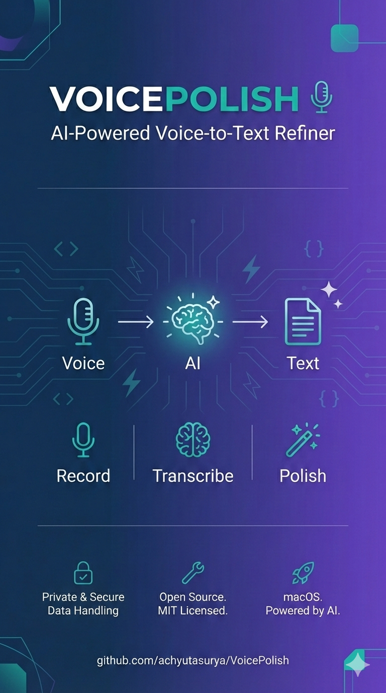

# VoicePolish - AI-Powered Voice-to-Text Refiner for macOS

> **Open Source** | Record your voice, transcribe with AI, and auto-paste refined text into any app

[](https://opensource.org/licenses/MIT)

## What is VoicePolish?

VoicePolish is a lightweight macOS menubar application that transforms raw voice recordings into polished, refined text. Simply press your hotkey, speak naturally, and the app automatically transcribes and refines your speech using AI before pasting it into your active application.

### Features

🎤 **Voice Recording** - Global hotkey activation (Cmd+]) for quick recording
🧠 **AI Transcription** - Uses Deepgram's advanced speech-to-text engine
✨ **LLM Refinement** - Cleans up transcription with OpenRouter-powered AI models
📋 **Auto-Paste** - Automatically pastes refined text into any application (Cmd+V)
⌨️ **Stop & Type** - Character-by-character typing simulation for Citrix/VDI environments where clipboard paste doesn't work. Configurable speed presets (50/80/120 WPM)
📖 **Custom Vocabulary** - Boost Deepgram's recognition of domain-specific words (e.g., "Tavily", "MCP", "Context7") with keyterm prompting for Nova-3 or keyword boosting for older models. Toggle on/off in settings
📜 **History** - Browse past transcriptions alongside their LLM-processed outputs. Filter by time range, paginate, and bulk-copy transcripts or LLM outputs
⚙️ **Customizable** - Configure temperature, model selection, and system prompts
🔧 **Privacy-Focused** - All processing respects your configured API keys

## Requirements

- **macOS 14.0+** (Sonoma or later)
- **Swift 5.9+**
- **API Keys** (free tiers available):
  - [Deepgram](https://console.deepgram.com/) - Speech-to-text
  - [OpenRouter](https://openrouter.ai/) - LLM processing

## Installation

### Option 1: Download Pre-built App

1. Download `VoicePolish.app` from the [`releases/`](releases/) folder
2. Move it to `/Applications/`
3. Right-click the app → **Open** (required on first launch since the app is ad-hoc signed)
4. Grant Microphone and Accessibility permissions when prompted

### Option 2: Build from Source

```bash
# Clone the repository
git clone https://github.com/achyutasurya/VoicePolish.git
cd VoicePolish

# Build the release app
bash build.sh

# Deploy to /Applications
cp -R VoicePolish.app /Applications/
rm -rf VoicePolish.app
open /Applications/VoicePolish.app
```

## Quick Start

1. **Get API Keys**
   - Sign up for [Deepgram](https://console.deepgram.com/) (free tier: 12,000 minutes/month)
   - Sign up for [OpenRouter](https://openrouter.ai/) (pay-as-you-go or free tier)

2. **Launch VoicePolish**
   - Open `VoicePolish.app`
   - Click the microphone icon in your menubar

3. **Configure Settings**
   - Enter your Deepgram API key
   - Enter your OpenRouter API key
   - Select your preferred LLM model (Gemini 2.5 Flash recommended)
   - Set temperature (0.0 = deterministic, 1.0+ = creative)

4. **Grant Permissions**
   - Allow Microphone access
   - Allow Accessibility (required for auto-paste)

5. **Start Using**
   - Press `Cmd+]` to start recording
   - Press `Cmd+]` again (or click **Stop & Paste**) to stop and auto-paste into your active app
   - Use **Stop & Type** instead for Citrix/VDI environments where clipboard paste doesn't work
   - Press `Cmd+[` to cancel a recording without sending

## Configuration

### Available LLM Models

- **Gemini 2.5 Flash** (Recommended) - Fast, cost-effective, great results
- DeepSeek Chat - Cost-effective alternative
- Claude 3 Haiku - Fast response, high quality
- Claude Sonnet 4 - Premium quality
- GPT-4o - OpenAI's latest
- Llama 3.3 70B - Open source option
- Custom model support via model ID

### Temperature Settings

- **0.0 - 0.3**: Deterministic (recommended for cleanup tasks)
- **0.3 - 0.7**: Balanced (consistent with minor variation)
- **0.7 - 1.0**: Creative (more varied output)
- **1.0+**: Very Creative (slower with reasoning models)

### Custom System Prompt

Customize how the LLM processes your transcriptions. Default prompt focuses on grammar, punctuation, and filler word removal while preserving meaning.

## Architecture

```
Hotkey (Cmd+])
  ↓
Start Recording (instant — before popup appears)
  ↓
Show Recording Popup (non-activating, preserves focus)
  ↓
Hotkey again (or Stop & Paste / Stop & Type button)
  ↓
Transcribe (Deepgram STT + custom vocabulary boosting)
  ↓
Process with LLM (OpenRouter)
  ↓
Save to History
  ↓
Re-activate target app → Paste (Cmd+V) or Type (character-by-character) → Restore clipboard
```

The audio engine is reused across recordings (kept running with a permanent tap) to eliminate cold-start delay. Recording starts before the popup renders to capture speech from the instant the hotkey is pressed.

## Versioning

VoicePolish uses a **`MAJOR.DEPLOY.LOCAL`** scheme (e.g. `0.1.1`):

| Segment | Meaning |
|---------|---------|
| `MAJOR` | Breaking changes or major milestones |
| `DEPLOY` | Incremented on each production push; resets `LOCAL` to `0` |
| `LOCAL` | Incremented on each local build/test cycle |

The current version is displayed at the bottom of the Settings panel. See [CHANGELOG.md](CHANGELOG.md) for the full history.

## Logging

Logs are written to:
```
~/Library/Logs/VoicePolish/voicepolish-YYYY-MM-DD.log
```

View logs for debugging API issues, focus problems, or transcription errors.

## Development

### Project Structure

```
VoicePolish/
├── VoicePolish/                  # Main app source
│   ├── VoicePolishApp.swift     # App entry point & AppState
│   ├── Models/                  # Data models
│   │   ├── AppSettings.swift    # User settings (UserDefaults)
│   │   ├── LLMModels.swift      # Available LLM/Deepgram models
│   │   ├── HistoryEntry.swift   # History record model
│   │   └── HistoryTimeFilter.swift  # Time filter enum
│   ├── Services/                # Business logic
│   │   ├── AudioRecorder.swift  # AVAudioEngine recording
│   │   ├── DeepgramService.swift    # Speech-to-text + custom vocabulary
│   │   ├── OpenRouterService.swift  # LLM processing
│   │   ├── TextInsertionService.swift  # Paste & type simulation
│   │   ├── HistoryService.swift     # JSON-backed history persistence
│   │   └── LoggingService.swift
│   ├── Views/                   # SwiftUI interfaces
│   │   ├── RecordingPopupView.swift  # Recording UI + pipeline
│   │   ├── SettingsView.swift   # Tabbed settings (Settings/History)
│   │   ├── HistoryView.swift    # History tab with filtering/pagination
│   │   ├── APIKeyView.swift
│   │   └── SystemPromptView.swift
│   ├── Utilities/               # Helpers
│   │   ├── AppVersion.swift     # Version constant
│   │   ├── HotkeyManager.swift
│   │   └── PermissionManager.swift
│   └── Info.plist               # App configuration
├── releases/                    # Pre-built app download
│   └── VoicePolish.app
├── Package.swift                # SPM manifest
├── build.sh                     # Release build script
├── VERSION                      # Version source of truth
├── CHANGELOG.md                 # Version history & notes
├── LICENSE                      # MIT License
└── README.md                    # This file
```

### Dependencies

- **KeyboardShortcuts** (sindresorhus, v2+) — Global hotkey registration

### Building

```bash
# Debug build
swift build

# Release build (creates signed .app)
bash build.sh
```

## Troubleshooting

### App Won't Paste Text
- Check if Accessibility permission is granted (Settings → Accessibility)
- Ensure target app accepts keyboard input
- Check logs: `tail -f ~/Library/Logs/VoicePolish/voicepolish-*.log`

### Transcription Failing
- Verify Deepgram API key is valid
- Check microphone permissions
- Ensure internet connection is stable

### Processing Taking Too Long
- High temperature settings increase processing time
- Reasoning models are slower — try DeepSeek Chat instead
- Check OpenRouter API status

### API Key Not Being Saved
- Clear app cache: `rm ~/Library/Preferences/com.voicepolish.app*`
- Re-enter API keys in settings

## Contributing

Contributions are welcome! Please feel free to submit Pull Requests for bug fixes, features, or improvements.

## License

This project is licensed under the MIT License - see the [LICENSE](LICENSE) file for details.

## Acknowledgments

- [Deepgram](https://deepgram.com/) - Speech-to-text engine
- [OpenRouter](https://openrouter.ai/) - LLM API aggregator
- [KeyboardShortcuts](https://github.com/sindresorhus/KeyboardShortcuts) - Global hotkey support

## Disclaimer

This is a personal project. Use at your own risk. Remember to:
- Keep your API keys secure
- Monitor your API usage and costs
- Respect rate limits of third-party services

---

**Questions or Issues?** Please open an issue on GitHub.

Happy voice polishing! 🎤✨
